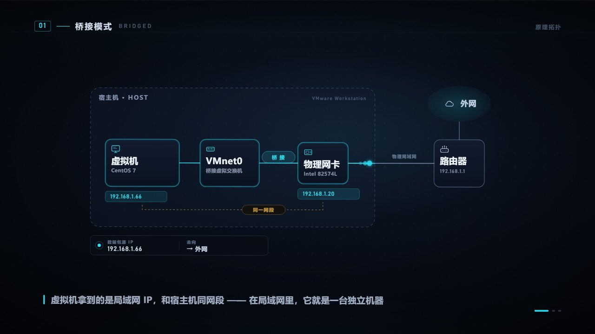
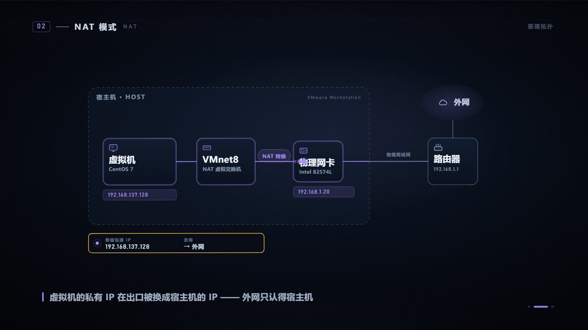
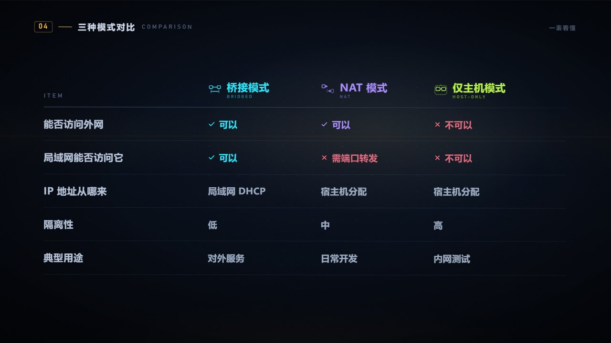

# vibevideo_vmnet

> **Vibe 知识大赏 EP.01 —— VMware 三种网络工作模式：原理与区别**
>
> 一支 2 分 15 秒的纯代码动画科普短片，用 Remotion 制作，全程跟背景音乐卡鼓点，画面音效全部由代码合成。



## 成片

**[⬇ 下载 1080P 成片（GitHub Release）](../../releases/latest)**

| 项目 | 参数 |
| --- | --- |
| 分辨率 | 1920 × 1080（16:9） |
| 帧率 | 30 fps |
| 时长 | 135.2 s（4056 帧） |
| 视频 | H.264 / CRF 16 / yuv420p |
| 音频 | AAC 320 kbps / 48 kHz 立体声 |
| 响度 | -15 LUFS，真峰值 -1.0 dBFS |

## 内容结构

全片以 BGM 的 112.3 BPM 为基准，**所有场景切点都落在小节首拍上**（一小节 ≈ 2.14 s）。

| 时间 | 段落 | 内容 |
| --- | --- | --- |
| 0:00 | 开场 | VMware 标题随第一记重鼓砸入 |
| 0:04 | 痛点 | "让它上网" → 报错卡"无法访问网络" |
| 0:09 | 预告 | 桥接 / NAT / 仅主机 三张模式卡 |
| 0:13 | 提问 | 虚拟机想上网，三条路从宿主机发散 |
| 0:21 | **桥接模式** | 标题 → 拓扑动画 → 三条要点 |
| 0:43 | **NAT 模式** | 同上，含"源地址改写"与"外网无法主动连入" |
| 1:04 | **仅主机模式** | 同上，含隔离墙 |
| 1:25 | 间奏 | 一张"开放度光谱"：桥接 → NAT → 仅主机 |
| 1:33 | 对比 | 五行对比表 + "怎么选"三张场景卡 |
| 1:55 | 高潮 | 三句口诀 → "需不需要被外面看见？" |
| 2:11 | 收尾 | 三模式同框 + 落版 |

<table>
<tr>
<td></td>
<td></td>
</tr>
<tr>
<td align="center">NAT：源 IP 在出口被改写</td>
<td align="center">五行对比表</td>
</tr>
</table>

## 设计上的几个决定

**同一套拓扑骨架，只换中间那颗开关。**
三个模式章节共用「宿主机容器 → 虚拟机 → VMnetX → 物理网卡 → 局域网 → 外网」的布局，观众盯着同一张图看变化，差别自然就出来了——而不是三张各画各的图。

**把"数据包源 IP"做成固定 HUD。**
底部常驻一行读数，NAT 那一刻从 `192.168.137.128` 跳成 `192.168.1.20` 并转为琥珀色。全片最关键的认知点，用一帧就讲完了。

**音效全部由代码合成。**
`scripts/gen_sfx.py` 用 numpy 合成 23 个 wav：impact 负责卡鼓点，whoosh 负责转场，pop / tick 负责元素入场，datazip 是数据流动，error 是隔离墙与外网阻断。零版权风险，且可以随时调参重生成。

**节拍表是唯一的时间源。**
`src/beats.ts` 内置 246 个拍点、TOP20 强拍、176 个强鼓点。场景切点、元素入场、音效触发全部引用这张表，改 BGM 只需换一份分析数据。

## 快速开始

```bash
npm install

# 从 Windows 系统字体提取三款字体（不入库，见下方说明）
python scripts/extract_fonts.py

# 预览 / 调参
npm run dev

# 渲染成片
npx remotion render Video out/video.mp4 --concurrency=4
```

> **关于字体**：工程使用 Microsoft YaHei（中文字幕）与 Bahnschrift（数字与英文）。
> 二者为系统字体，不随仓库分发，需用 `scripts/extract_fonts.py` 从本机
> `C:\Windows\Fonts` 提取到 `public/fonts/`。脚本依赖 `fonttools`。

## 目录结构

```
src/
  theme.ts              设计令牌：色板、字体、时长
  beats.ts              节拍表与脉冲函数（beatPulse / barPulse / hitPulse）
  sound.ts              音效时间轴（约 100 条事件，逐条对齐节拍）
  Video.tsx             主合成：场景编排、镜头推进、闪白、混音
  components/
    Backdrop.tsx        背景：光晕、点阵、扫描线、颗粒
    Text.tsx            逐字升起 / 淡入 / 遮罩展开
    UI.tsx              页眉、章节大标题、要点行、结语条
    Diagram.tsx         三模式拓扑图（SVG，含数据包流动）
    ModeGlyph.tsx       模式图标与元数据
    SfxLayer.tsx        音效调度层
  scenes/               11 个场景
scripts/
  gen_sfx.py            合成全部音效
  extract_fonts.py      从系统提取字体
  preview.mjs           生成 README 预览图
  stills.mjs            批量导出指定帧
```

## 技术栈

Remotion 4 · React 19 · TypeScript · SVG 动画 · numpy 音频合成
